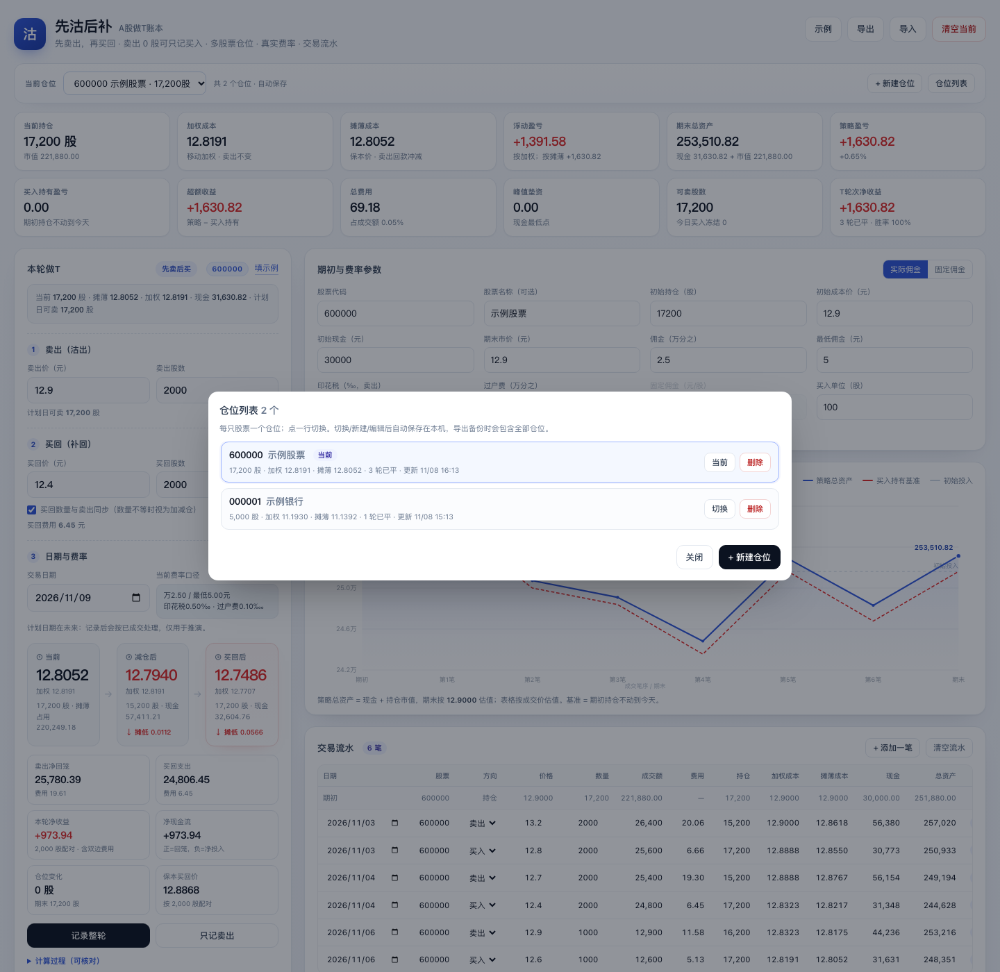

# 先沽后补 · A股做T账本（多仓位）

一个离线单页的 A 股做 T 账本：**每只股票一个仓位**，先卖后买、卖出 0 股可只记买入、真实费率、总资产曲线、交易流水、T+1 可卖校验、做 T 轮次统计。

> 个人复盘工具，不构成投资建议。费率以券商实际为准；调试签名 APK，适合个人侧载。

## 下载 APK

- **最新 APK**：[GitHub Releases · latest](../../releases/latest)
- 当前版本 **1.1.0（多仓位）**。
- 固定 debug 签名，可覆盖安装升级；安装时需允许“未知来源”。
- 数据只保存在手机本机，不上传服务器。

## 在线版（可选）

把仓库的 `docs/` 目录发布为 GitHub Pages：

`Settings → Pages → Deploy from a branch → main /docs`

发布地址：`https://<你的GitHub用户名>.github.io/xianguo-t-ledger/`

## 截图




## 多仓位

- 顶部「当前仓位」下拉切换；股票代码/名称同时显示在顶栏、计划卡、T轮次统计和交易流水。
- **+ 新建仓位**：填股票代码（必填，不能与已有仓位重复）、名称（可选）、期初持仓/成本/现金；创建后自动切换。
- **仓位列表**：查看所有股票的代码/名称、当前股数、加权/摊薄成本、已平/未平轮次、更新时间；可切换、删除。至少保留一个仓位。
- 每个仓位独立保存自己的期初、流水、计划、未平轮次；自动存到本机。
- 卖出 0 股只记买入、补记卖出、T+1、费率对照等逻辑都只作用于**当前仓位**。
- 旧单仓位账本（`xianguo-t.v1`）首次打开会自动迁移成一个仓位；此时股票代码为空，补上即可。
- 导出/复制备份会包含**全部仓位**；导入同时兼容新多仓位备份和旧单仓位备份。

## 功能

- 先卖后买：当前 → 减仓后 → 买回后，同时看加权成本与摊薄成本
- **卖出股数 = 0**：「只记卖出」自动变成「只记买入」，只写买入腿，进入“未平轮次 · 待卖出”；之后补记卖出
- 真实佣金 / 固定佣金两套费率，独立对照
- 总资产曲线 vs 买入持有基准
- 交易流水含「股票」列、T+1 可卖校验、做 T 轮次统计
- 数据只存 localStorage；APK 内「复制备份 / 粘贴导入」，浏览器版「导出 / 导入 JSON」
- 单文件 Web 应用，离线可用

## 费率默认值

- 实际佣金：佣金 2.5‱、最低 5 元、印花税 0.5‰（仅卖出）、过户费 0.1‱（双边，0.001%）
- 固定佣金：0.04 元/股（双边）

## 本地构建 APK

需要 JDK 21、Android SDK 36：

```bash
npm ci
npx cap sync android
cd android
./gradlew assembleDebug
# 产物：android/app/build/outputs/apk/debug/app-debug.apk
```

## GitHub Actions 自动构建

推送到 `main` 或 `master` 后，`.github/workflows/android.yml` 会：

1. 安装 Node 22、JDK 21、Android SDK 36
2. `npm ci` + `npx cap sync android`
3. `./gradlew assembleDebug`
4. 上传 artifact，并更新 **Release `latest`** 的 `xianguo-t-ledger-debug.apk`

构建完成后，在手机上打开：

`https://github.com/<你的用户名>/xianguo-t-ledger/releases/latest`

下载 APK 安装即可。

## 目录结构

```
www/                 # 单文件应用源（index.html）
docs/                # GitHub Pages 版本 + 截图
android/             # Capacitor Android 工程
assets/              # 图标 / 启动图源文件
.github/workflows/   # APK 自动构建
capacitor.config.json
```

## 数据与迁移

- 多仓位存储键：`xianguo-t.v2`；旧单仓位键 `xianguo-t.v1` 会保留，首次打开自动迁移。
- 迁移后的仓位股票代码为空，顶栏/流水会显示“未填代码”，在参数区补上即可。
- 换设备/清缓存前先「导出 / 复制备份」；导入会覆盖当前全部仓位。
- 调试签名 APK 不适合上架应用商店；需要上架时再生成正式 keystore。
- CI 每次构建会把 `versionCode` 自动加一，方便覆盖安装。
