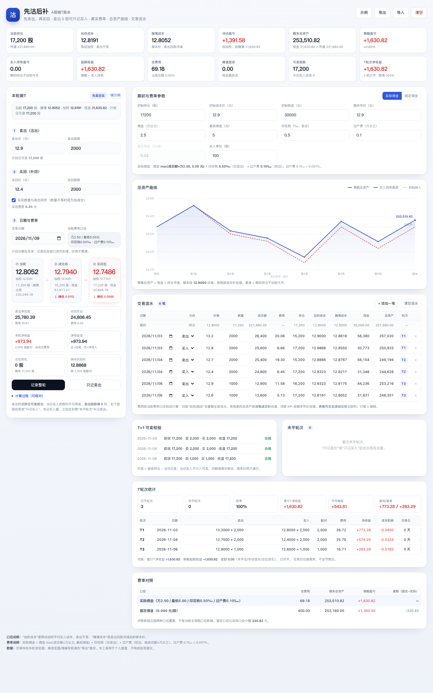
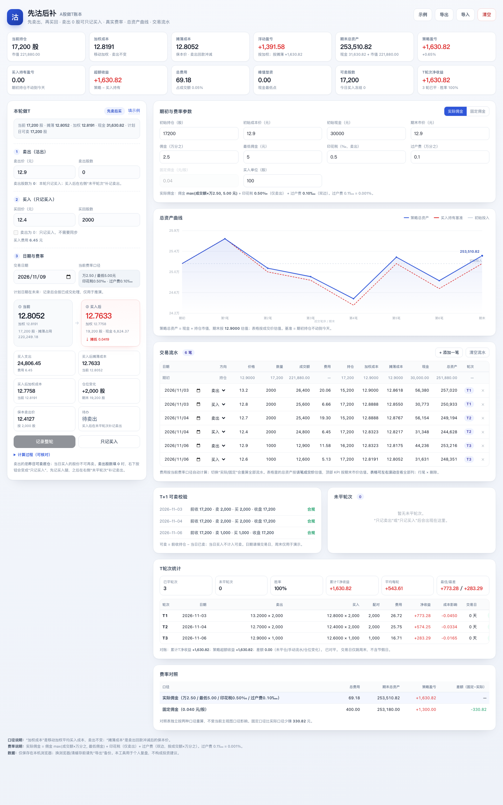

# 先沽后补 · A股做T账本

一个离线单页的 A 股做 T 账本：先卖后买（卖出股数填 0 可只记买入）、真实费率、总资产曲线、交易流水、T+1 可卖校验、做 T 轮次统计。

> 个人复盘工具，不构成投资建议。费率以券商实际为准；调试签名 APK，适合个人侧载。

## 下载 APK

- **最新 APK**：[GitHub Releases · latest](../../releases/latest)
- 当前为 **固定 debug 签名**，可覆盖安装升级；安装时需允许“未知来源”。
- 数据只保存在手机本机，不上传服务器。

## 在线版（可选）

把仓库的 `docs/` 目录发布为 GitHub Pages：

`Settings → Pages → Deploy from a branch → main /docs`

发布地址：`https://<你的GitHub用户名>.github.io/xianguo-t-ledger/`

## 截图





## 功能

- 先卖后买：当前 → 减仓后 → 买回后，同时看加权成本与摊薄成本
- **卖出股数 = 0**：「只记卖出」自动变成「只记买入」，只写买入腿，进入“未平轮次 · 待卖出”；之后补记卖出
- 真实佣金 / 固定佣金两套费率，独立对照
- 总资产曲线 vs 买入持有基准
- 交易流水、T+1 可卖校验、做 T 轮次统计
- 数据只存 localStorage；APK 内「复制备份 / 粘贴导入」，浏览器版「导出 / 导入 JSON」
- 单文件 Web 应用，离线可用

## 费率默认值

- 实际佣金：佣金 2.5‱、最低 5 元、印花税 0.5‰（仅卖出）、过户费 0.1‱（双边，0.001%）
- 固定佣金：0.04 元/股（双边）

## 本地构建 APK

需要 JDK 21、Android SDK 36：

```bash
npm ci
npx cap sync android
cd android
./gradlew assembleDebug
# 产物：android/app/build/outputs/apk/debug/app-debug.apk
```

## GitHub Actions 自动构建

推送到 `main` 或 `master` 后，`.github/workflows/android.yml` 会：

1. 安装 Node 22、JDK 21、Android SDK 36
2. `npm ci` + `npx cap sync android`
3. `./gradlew assembleDebug`
4. 上传 artifact，并更新 **Release `latest`** 的 `xianguo-t-ledger-debug.apk`

构建完成后，在手机上打开：

`https://github.com/<你的用户名>/xianguo-t-ledger/releases/latest`

下载 APK 安装即可。

## 目录结构

```
www/                 # 单文件应用源（index.html）
docs/                # GitHub Pages 版本 + 截图
android/             # Capacitor Android 工程
assets/              # 图标 / 启动图源文件
.github/workflows/   # APK 自动构建
capacitor.config.json
```

## 说明

- 首次打开有示例数据；点“清空”开始自己的账本。
- 换设备前先用「复制备份 / 导出」备份。
- 固定 debug 签名只用于个人侧载，不适合上架应用商店；需要上架时再生成正式 keystore。
- CI 每次构建会把 `versionCode` 自动加一，方便覆盖安装。
